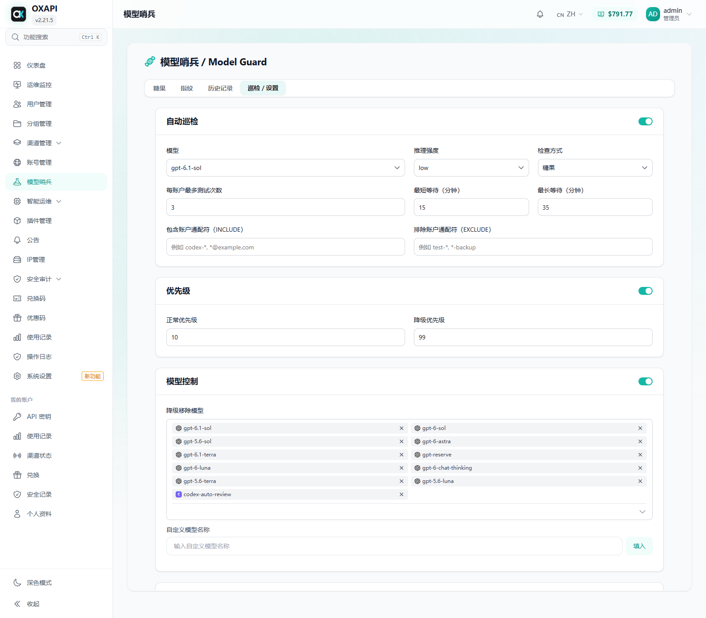
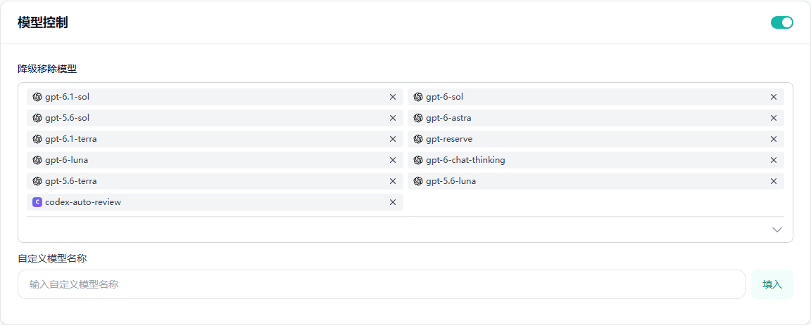

<div align="center">


# Sub2API · 模型哨兵

**社区版 Sub2API + Model Guard**

多账号 AI API 网关，保留 Sub2API 的账号、API Key、计费、调度和后台能力，并加入糖果测试、指纹检测、历史记录、定时巡检和降级模型控制。

[](https://github.com/Ericzhouyihe/sub2api-codex-guard)
[](https://golang.org/)
[](https://www.docker.com/)
[](LICENSE)

[快速部署](#快速部署) · [模型哨兵](#模型哨兵) · [社区版](#社区版) · [文档](#文档)

</div>

## 这个仓库是什么

本仓库基于 **`ranxi2001/sub2api` 社区版**（tosky.io 维护的独立分支），并按需合入 **`Wei-Shaw/sub2api`** 上游更新。

它在保留原版网关能力的同时，增加了 **Model Guard / 模型哨兵**：

- **糖果测试**：向账号发送固定问题，记录回答、用量、耗时和是否正确。
- **指纹检测**：用固定参考库和随机挑战做统计归因，给出候选模型排名。
- **历史记录**：按分组和账号聚合，糖果与指纹记录持久化保存。
- **定时巡检**：按分组、账号类型、订阅、可用性和通配符筛选，随机等待后逐账户检测。
- **自动处置**：可调整账号优先级，或把指定模型加入账号级独立限制列表；恢复正常后自动解除。
- **通知**：支持 ntfy 和 Bark。

> 本仓库是独立仓库，不是通过 GitHub Fork 按钮创建的，所以仓库页不会显示 fork 标识；代码血缘见上方说明。

## 界面



巡检 / 设置页包含自动巡检、降级优先级和模型控制。模型控制写入的是账号 `extra` 中的独立限制层，不会改写上游的 `credentials` 或 `model_mapping`。

## 快速部署

### 环境要求

- Linux 服务器，Docker 24+ 与 Docker Compose v2
- 建议 2 核 4 GB 内存以上；前端在容器内构建，首次约 10–15 分钟
- 一个可用的 PostgreSQL 和 Redis 由 Compose 自动启动，无需单独安装

### Docker Compose 一键构建

```bash
git clone https://github.com/Ericzhouyihe/sub2api-codex-guard.git
cd sub2api-codex-guard/deploy

cp .env.example .env
# 编辑 .env，至少设置：
#   POSTGRES_PASSWORD=一个强密码
#   ADMIN_EMAIL=你的管理员邮箱
#   ADMIN_PASSWORD=你的管理员密码
#   JWT_SECRET=$(openssl rand -hex 32)
#   TOTP_ENCRYPTION_KEY=$(openssl rand -hex 32)

mkdir -p data postgres_data redis_data

docker compose -f docker-compose.local.yml \
               -f docker-compose.model-guard.yml \
               up -d --build
```

查看启动日志：

```bash
docker compose -f docker-compose.local.yml \
               -f docker-compose.model-guard.yml \
               logs -f sub2api
```

启动后访问：

- 管理后台：`http://服务器IP:8080`
- 模型哨兵：`http://服务器IP:8080/admin/codex-eval`
- 健康检查：`http://服务器IP:8080/health`

如果 `.env` 中没有设置管理员账号，首次启动日志会出现 `Generated admin`，其中包含随机生成的登录信息。生产环境建议显式设置 `ADMIN_EMAIL` 和 `ADMIN_PASSWORD`。

> 本仓库目前没有发布预构建镜像，`docker-compose.model-guard.yml` 会在服务器本地构建当前源码。构建完成后，后续启动不需要再加 `--build`。

> **Docker 部署不要点页面上的“立即更新”。** 该按钮是二进制自更新，会尝试替换容器内的 `/app/sub2api`；容器内通常没有权限，重建容器后更新也会丢失，还可能把 Model Guard 版本替换成上游版本。请按 [升级 Runbook](docs/UPGRADING.md) 合并上游 tag、重建镜像并切换。

### 已有 Sub2API 升级

不要直接覆盖正在运行的数据目录。先备份 `data/`、PostgreSQL 和 `.env`，再按 [升级 Runbook](docs/UPGRADING.md) 做 canary 验证后切换生产镜像。升级流程包含备份、独立数据库 canary、健康检查、路由检查和回滚步骤。

## 模型哨兵

### 糖果测试

在「糖果」页选择分组、账号、模型、推理强度和每账户次数，然后开始测试。结果会显示回答、输入/输出 token、耗时、尝试次数和是否正确。

默认判断是回答中是否出现独立数字 **21**，这是一个轻量启发式，不是模型身份证明。测试会消耗真实上游额度。

### 指纹检测

「指纹」页使用固定参考库和随机挑战，对回答做统计归因，输出候选模型排名和原始样本。它适合观察账号实际可能路由到的模型，不应当作为单一封禁依据。

### 历史记录

历史按账号和检测类型聚合，默认保留每个账户每种类型最近 20 条记录，并持久化到应用数据目录的 `codex-eval/history.json`。清空记录前请确认不再需要审计证据。

### 定时巡检

在「巡检 / 设置」中开启自动巡检，配置：

- 分组、模型、推理强度和检查方式（糖果 / 指纹）
- 每账户最多测试次数
- 最短 / 最长随机等待时间（默认 15–35 分钟）
- 包含 / 排除账户通配符
- ntfy / Bark 通知

巡检调度是进程内的，没有分布式主选举。**只在一个管理实例上开启自动巡检**，避免同一账号被重复检测和重复扣费。

### 降级模型控制

模型控制解决的是“账号被判定降级后，不再把某些模型调度到该账号”：

- 只把指定的精确模型 ID 写入该账号的独立限制列表，不改写上游模型映射。
- 调度时请求模型及其映射目标都会被检查；别名或通配符指向同一上游模型时也会被拦截。
- 恢复正常后，只清除本功能写入的限制，不影响质量隔离、冷却、白名单或人工停用。
- 关闭「模型控制」只会停止新增限制，不会立即清除已有列表。
- 与「降级优先级」不同：优先级把账号从 10 降到 99 但仍可调度；移除模型是这些模型对该账号直接不可调度。



推荐使用顺序：先手动跑糖果 / 指纹测试，确认账号和模型选择正确；再在小范围分组开启巡检；观察一段时间历史记录后，最后再开启优先级和模型控制。

## 社区版

本仓库的网关主体来自社区版 Sub2API：

- 社区版仓库：<https://github.com/ranxi2001/sub2api>
- 使用文档：<https://tosky.io/docs/>
- 版本发布：<https://github.com/ranxi2001/sub2api/releases>
- 上游官方：<https://github.com/Wei-Shaw/sub2api>
- 交流群：QQ「中转技术交流」**1004036018**

社区版保留了多账号管理、API Key 分发、Token 级计费、智能调度、并发控制、速率限制、内置支付、管理后台等能力。Model Guard 是在此基础上的独立功能分支。

## 文档

| 文档 | 内容 |
|------|------|
| [模型哨兵说明](docs/model-guard.md) | 功能边界、配置、检测局限、存储和部署注意事项 |
| [升级 Runbook](docs/UPGRADING.md) | 上游版本合并、测试、备份、canary、生产切换和回滚 |
| [部署说明](deploy/README.md) | Docker Compose、二进制、Kubernetes 等完整部署方式 |
| [升级规格](specs/001-sub2api-upgrade-runbook/spec.md) | 本仓库的可复用升级流程和验收标准 |
| [上游文档](https://github.com/Wei-Shaw/sub2api) | Sub2API 官方功能与配置说明 |

## 安全与边界

- 使用本项目可能违反上游服务商的服务条款；请在符合当地法律法规的前提下使用。
- 检测和巡检会消耗真实上游额度，并可能触发上游风控；请先用小范围账号验证。
- 糖果结果是指标，不是模型身份证明；指纹结果是统计归因，不是确定性证据。
- 不要提交 Token、OAuth 导出、ticket、代理凭据或生产配置到仓库。
- 本项目未授权任何个人或组织基于本项目开展商业化运营。

## 许可证

本项目基于 [GNU 宽通用公共许可证 v3.0](LICENSE)（或更高版本）授权。

Copyright (c) 2026 Wesley Liddick

---

<div align="center">

**如果这个分支对你有帮助，欢迎给仓库一个 Star。**

</div>
