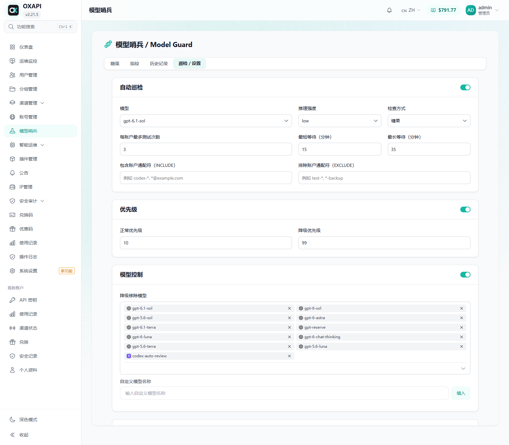
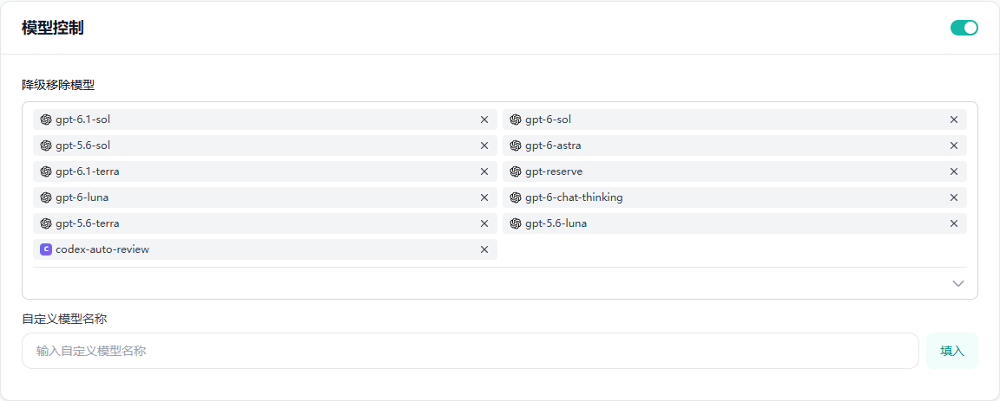

<div align="center">


# Sub2API · Model Guard

**Sub2API Community Edition + Model Guard**

A multi-account AI API gateway based on Sub2API. It retains Sub2API's account, API key, billing, scheduling and admin capabilities, and adds candy tests, fingerprint detection, history, scheduled inspections and degraded-model control.

[](https://github.com/Ericzhouyihe/sub2api-codex-guard)
[](https://golang.org/)
[](https://www.docker.com/)
[](LICENSE)

[简体中文](README.md) | [English](README_EN.md)

[Quick Deployment](#quick-deployment) · [Model Guard](#model-guard) · [Community Edition](#community-edition) · [Documentation](#documentation)

</div>

## What This Repository Is

This repository is based on the **community edition of `ranxi2001/sub2api`** (an independent branch maintained by tosky.io), with selected upstream updates merged from **`Wei-Shaw/sub2api`** as needed.

While retaining the original gateway capabilities, it adds **Model Guard**:

- **Candy tests**: send fixed questions to an account and record the answer, usage, latency and whether the answer was correct.
- **Fingerprint detection**: perform statistical attribution using a fixed reference library and random challenges, and produce a ranked list of candidate models.
- **History**: aggregate records by group and account; candy and fingerprint records are persisted.
- **Scheduled inspections**: filter accounts by group, account type, subscription, availability and wildcards, then test them one by one after a random wait.
- **Automatic handling**: adjust account priority, or add selected models to an account-level independent restriction list; restrictions are removed automatically after recovery.
- **Notifications**: ntfy and Bark.

> This repository is a **GitHub fork of `ranxi2001/sub2api`**, so the repository page shows a fork badge. Code lineage and upstream merge records are preserved in the Git history.

## Screenshots



The Inspection / Settings page includes scheduled inspection, degradation priority and model control. Model control writes to an independent restriction layer in the account's `extra` field; it does not rewrite the upstream `credentials` or `model_mapping`.

## Quick Deployment

### Requirements

- A Linux server with Docker 24+ and Docker Compose v2
- 2 CPU cores and 4 GB of RAM or more recommended
- PostgreSQL and Redis are started automatically by Compose; no separate installation is required

### One-Command Docker Compose Deployment (Prebuilt GHCR Image)

Images are built and pushed automatically by GitHub Actions when a tag is created. The server only pulls the image; the frontend does not need to be built locally.

```bash
git clone https://github.com/Ericzhouyihe/sub2api-codex-guard.git
cd sub2api-codex-guard/deploy

cp .env.example .env
# Edit .env and set at least:
#   POSTGRES_PASSWORD=a-strong-password
#   ADMIN_EMAIL=your-admin-email
#   ADMIN_PASSWORD=your-admin-password
#   JWT_SECRET=$(openssl rand -hex 32)
#   TOTP_ENCRYPTION_KEY=$(openssl rand -hex 32)

mkdir -p data postgres_data redis_data

# If the GHCR package is private, log in once (the PAT needs read:packages):
# echo "$CR_PAT" | docker login ghcr.io -u Ericzhouyihe --password-stdin

docker compose -f docker-compose.local.yml up -d
```

`docker-compose.local.yml` already includes Watchtower. It checks for a new image every 5 minutes and updates only the `sub2api` container labeled `com.centurylinklabs.watchtower.enable=true`; PostgreSQL and Redis are left untouched. Set `WATCHTOWER_HTTP_API_TOKEN` and enable `WATCHTOWER_HTTP_API_UPDATE` to add an "Update Image Now" button to the admin version popover; it triggers the same image pull immediately.

View the startup logs:

```bash
docker compose -f docker-compose.local.yml logs -f sub2api
```

After startup, open:

- Admin dashboard: `http://server-ip:8080`
- Model Guard: `http://server-ip:8080/admin/codex-eval`
- Health check: `http://server-ip:8080/health`

If no admin account is configured in `.env`, the first startup log will contain `Generated admin` with randomly generated login credentials. For production, set `ADMIN_EMAIL` and `ADMIN_PASSWORD` explicitly.

### Automated Builds and Updates

- Pushing a `v*` tag (for example `v2.21.5`) triggers `.github/workflows/docker-image.yml`, which builds `ghcr.io/ericzhouyihe/sub2api-codex-guard:2.21.5`, `:latest` and `:sha-*`, and creates a GitHub Release with the same name.
- You can also bump `backend/cmd/server/VERSION` and push to `feat/model-guard`: if the `vX.Y.Z` tag does not exist, the workflow creates the tag and GitHub Release automatically, then pushes the versioned image and `:latest` to GHCR. Watchtower on the server pulls and recreates the container on its next poll (5 minutes by default). Pushes without a version bump only build branch/`sha-*` images and do not move `latest`.
- Watchtower on the server automatically pulls `:latest` and recreates `sub2api`. You can also do it manually:
  ```bash
  docker compose -f docker-compose.local.yml pull sub2api
  docker compose -f docker-compose.local.yml up -d sub2api
  ```
- Docker mode never replaces the binary inside the container: updates only happen by pulling the fork image. Without the Watchtower HTTP API the page shows the manual command; once configured it shows "Update Image Now", Watchtower pulls and recreates the container, and the page refreshes when the service is back.
- The one-click path only updates images **published by this fork**. A new `ranxi2001/sub2api` upstream release still has to go through the upstream-sync PR first. After that merge, `VERSION` becomes the upstream version and the workflow creates the tag/Release and image automatically; installing the upstream binary directly would remove Model Guard.
- The server compose file must use `image: ghcr.io/ericzhouyihe/sub2api-codex-guard:latest` and keep the `sub2api` `com.centurylinklabs.watchtower.enable=true` label plus the `watchtower` service. A pinned version tag does not follow new releases automatically.
- To build from source only, add the `docker-compose.model-guard.yml` override:
  ```bash
  docker compose -f docker-compose.local.yml \
                 -f docker-compose.model-guard.yml \
                 up -d --build
  ```

### GitHub Actions

The repository keeps only three workflows directly related to this fork:

- `ci.yml`: runs the Go unit tests related to Model Guard.
- `docker-image.yml`: builds and pushes the GHCR image on a tag or on a push to the `feat/model-guard` branch; when `VERSION` changes and its tag does not exist, it also creates the tag/Release and updates `:latest`.
- `security-scan.yml`: runs `govulncheck` and `pnpm audit` weekly and on push/PR.

The one-off upstream PR/issue regression workflows have been removed to avoid a large number of checks in the fork that never trigger or are bound to fail.

### Upgrading an Existing Sub2API Deployment

Do not overwrite a running data directory directly. Back up `data/`, PostgreSQL and `.env` first, then follow the [Upgrade Runbook](docs/UPGRADING.md) to validate with a canary before switching the production image. The procedure covers backup, an isolated database canary, health checks, routing checks and rollback.

## Model Guard

### Candy Tests

On the **Candy** page, select the group, account, model, reasoning effort and number of attempts per account, then start the test. Results show the answer, input/output tokens, latency, number of attempts and whether the answer was correct.

The default check is whether the standalone number **21** appears in the answer. This is a lightweight heuristic, not proof of model identity. Tests consume real upstream quota.

### Fingerprint Detection

The **Fingerprint** page uses a fixed reference library and random challenges to perform statistical attribution on answers, producing candidate model rankings and raw samples. It is useful for observing which models an account may actually route to, but it should not be used as the sole basis for a ban.

### History

History is aggregated by account and detection type. By default, the latest 20 records of each type are kept for each account and persisted to `codex-eval/history.json` in the application data directory. Confirm that audit evidence is no longer needed before clearing records.

### Scheduled Inspections

Enable scheduled inspection in **Inspection / Settings** and configure:

- group, model, reasoning effort and inspection method (candy / fingerprint)
- maximum number of tests per account
- minimum / maximum random wait time (default 15–35 minutes)
- account include / exclude wildcards
- ntfy / Bark notifications

Inspection scheduling runs in-process and has no distributed leader election. **Enable scheduled inspection on only one admin instance** to avoid duplicate testing and duplicate charges for the same account.

### Degraded-Model Control

Model control addresses the case where an account has been judged degraded and certain models should no longer be scheduled to it:

- Only the specified exact model IDs are written to the account's independent restriction list; the upstream model mapping is not rewritten.
- During scheduling, both the requested model and its mapping target are checked; aliases or wildcards that resolve to the same upstream model are also blocked.
- After recovery, only restrictions written by this feature are removed; quality isolation, cooldowns, allowlists and manual suspension are unaffected.
- Turning off **Model Control** only stops new restrictions from being added; it does not immediately clear the existing list.
- This differs from **degradation priority**: priority lowers an account from 10 to 99 but the account remains schedulable, whereas removing models makes those models completely unschedulable for that account.



Recommended rollout order: first run candy / fingerprint tests manually to confirm that the account and model selections are correct; then enable scheduled inspection for a small group; after observing history for a period, finally enable priority adjustment and model control.

## Community Edition

The gateway core of this repository comes from the community edition of Sub2API:

- Community edition repository: <https://github.com/ranxi2001/sub2api>
- Documentation: <https://tosky.io/docs/>
- Releases: <https://github.com/ranxi2001/sub2api/releases>
- Upstream official repository: <https://github.com/Wei-Shaw/sub2api>
- Community group: QQ "Relay Tech Exchange" **1004036018**

The community edition retains multi-account management, API key distribution, token-level billing, intelligent scheduling, concurrency control, rate limiting, built-in payments, the admin dashboard and more. Model Guard is an independent feature branch built on top of it.

## Documentation

| Document | Contents |
|----------|----------|
| [Model Guard Guide](docs/model-guard.md) | Feature boundaries, configuration, detection limitations, storage and deployment notes |
| [Upgrade Runbook](docs/UPGRADING.md) | Upstream version merging, testing, backup, canary, production switch and rollback |
| [Upstream Sync](docs/UPSTREAM_SYNC.md) | Automatic upstream tag detection, merging, integrity checks and PR workflow |
| [Multi-Device Collaboration](docs/MULTI_DEVICE.md) | Branch model, device initialization, spec sharing and manual conflict handling |
| [Deployment Guide](deploy/README.md) | Complete deployment options including Docker Compose, binary and Kubernetes |
| [Upstream Documentation](https://github.com/Wei-Shaw/sub2api) | Official Sub2API features and configuration |

## Security and Boundaries

- Using this project may violate the terms of service of upstream providers; use it only in compliance with applicable laws and regulations.
- Detection and inspection consume real upstream quota and may trigger upstream risk controls; validate with a small set of accounts first.
- Candy results are indicators, not proof of model identity; fingerprint results are statistical attribution, not definitive evidence.
- Do not commit tokens, OAuth exports, tickets, proxy credentials or production configuration to the repository.
- This project has not authorized any individual or organization to conduct commercial operations based on this project.

## License

This project is licensed under the [GNU Lesser General Public License v3.0](LICENSE) (or later).

Copyright (c) 2026 Wesley Liddick

---

<div align="center">

**If this branch is helpful to you, please give the repository a star.**

</div>
